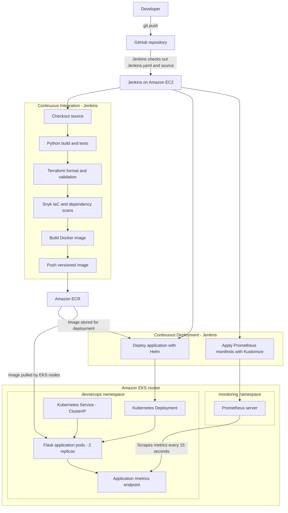

# AWS DevSecOps Platform

An example DevSecOps project that builds a Python Flask application, scans the code and infrastructure, packages the application as a Docker image, pushes it to Amazon ECR, and deploys it to Amazon EKS using Jenkins and Helm. Prometheus collects application and Prometheus server metrics inside the EKS cluster.

## Project architecture



## Main components

| Component | Purpose |
|---|---|
| GitHub | Stores application source, Terraform, Helm, Jenkins pipeline, and monitoring configuration. |
| Jenkins on EC2 | Runs the CI/CD pipeline. The EC2 instance uses an IAM role to access AWS services. |
| Terraform | Manages the Jenkins/AWS resources and the EKS cluster resources in separate working directories and state files. |
| Snyk | Scans Terraform infrastructure configuration and Python dependencies. |
| Docker | Builds the Flask application image. |
| Amazon ECR | Stores versioned Docker images. |
| Amazon EKS | Runs the Kubernetes application workloads. |
| Helm | Installs and upgrades the application using the chart in `helm/`. |
| Prometheus | Scrapes the application `/metrics` endpoint and its own metrics endpoint. |

## Repository structure

```text
aws-devsecops-project/
├── Jenkins.yaml
├── src/
│   ├── app.py
│   ├── requirements.txt
│   └── Dockerfile
├── helm/
│   ├── Chart.yaml
│   ├── values.yaml
│   └── templates/
│       ├── deployment.yaml
│       └── service.yaml
├── monitoring/
│   └── prometheus/
│       ├── kustomization.yaml
│       ├── namespace.yaml
│       ├── deployment.yaml
│       ├── service.yaml
│       └── prometheus.yml
└── terraform/
    ├── ec2.tf
    ├── ecr.tf
    ├── iam.tf
    ├── jenkins-eks-iam.tf
    ├── main.tf
    ├── outputs.tf
    ├── provider.tf
    ├── variable.tf
    └── eks/
        ├── cluster.tf
        ├── iam.tf
        ├── jenkins-access.tf
        ├── nodes.tf
        ├── outputs.tf
        ├── provider.tf
        └── variables.tf
```

## AWS environment

The project has been configured and tested in the following environment:

- AWS Region: `ap-south-1` (Asia Pacific — Mumbai)
- EKS cluster: `aws-devsecops-eks`
- Kubernetes version configured in Terraform: `1.36`
- EKS node group: `aws-devsecops-eks-workers`
- ECR repository: `aws-devsecops-app`
- Jenkins EC2 IAM role: `jenkins-devsecops-role`
- Application namespace: `devsecops`
- Monitoring namespace: `monitoring`
- Helm release: `aws-devsecops-app`

The Jenkins EC2 instance assumes its IAM role to authenticate to AWS. The role has ECR permissions, permission to describe the EKS cluster, and an EKS access entry with an associated access policy.

> **Learning-lab security note:** The current EKS access entry uses `AmazonEKSClusterAdminPolicy` with cluster-wide scope so Jenkins can deploy the example workloads. This is broad access and should be replaced with a least-privilege, namespace-scoped policy before using this design in production. Do not commit private keys, AWS credentials, Snyk tokens, or Terraform state files to Git.

## Jenkins pipeline

The Jenkins job is configured to load `Jenkins.yaml` from this repository. The pipeline runs these stages:

1. **Checkout** — checks out the source from GitHub.
2. **Python Build and Test** — creates a virtual environment, installs `src/requirements.txt`, and runs a Python syntax compilation check.
3. **Terraform Validation** — runs `terraform fmt -check -recursive`, initializes the provider without a backend, and runs `terraform validate` in `terraform/`.
4. **Snyk Security Scan** — scans Terraform IaC for high and critical severity issues and scans the Python dependencies.
5. **Docker Build** — builds the application image and tags it with the Jenkins build number.
6. **Push to ECR** — authenticates to ECR using the EC2 IAM role and pushes the versioned image.
7. **Deploy to EKS using Helm** — updates kubeconfig, checks the cluster nodes, and runs `helm upgrade --install` using the image tag from the current build.
8. **Deploy Prometheus Monitoring** — applies the manifests in `monitoring/prometheus/` using Kustomize and waits for the Prometheus Deployment rollout.
9. **Verify EKS Rollout** — waits for the application Deployment and displays the application pods and Service.

The Snyk IaC stage currently uses `--severity-threshold=high`, so high and critical IaC findings fail that scan; medium and low IaC findings are reported but do not stop this stage. The Python dependency scan uses the Snyk CLI defaults.

### Jenkins prerequisites

Configure the following on the Jenkins EC2 instance and in Jenkins:

- AWS CLI, Docker, kubectl, Helm, Terraform, Python 3, Git, and Snyk CLI installed and available on `PATH`.
- EC2 instance profile attached with the required IAM permissions.
- Jenkins credential named `snyk-token` containing the Snyk API token.
- Jenkins job configured to use this repository and the `main` branch, with `Jenkins.yaml` as its pipeline script.

Do not put AWS access keys or the Snyk token directly in the pipeline file.

## Application endpoints

The Flask application listens on port `5000` and provides:

| Path | Purpose |
|---|---|
| `/` | Returns the sample Hello World response. |
| `/health` | Returns a basic health status response. |
| `/metrics` | Exposes Prometheus metrics through `prometheus-flask-exporter`. |

The Helm Deployment runs two replicas. The container runs as a non-root user and uses a read-only root filesystem. A writable `emptyDir` volume is mounted at `/tmp` so Gunicorn can create its temporary files without making the container root filesystem writable.

## Prometheus monitoring

Prometheus is deployed by Jenkins from the Kubernetes manifests in `monitoring/prometheus/`.

The Kustomize configuration includes:

- `namespace.yaml` — creates the `monitoring` namespace.
- `deployment.yaml` — runs one Prometheus replica using `prom/prometheus:v3.16.0`.
- `service.yaml` — exposes Prometheus on port `9090` inside the cluster using a `ClusterIP` Service.
- `prometheus.yml` — configures scrape jobs for Prometheus itself and the Flask application.

Prometheus scrapes targets every 15 seconds:

- Prometheus: `localhost:9090`
- Flask application: `aws-devsecops-app.devsecops.svc.cluster.local:5000/metrics`

The Prometheus Deployment currently uses `emptyDir` storage. This is suitable for a learning/demo environment; metrics history is not persistent if the Prometheus pod is replaced. Use persistent storage for a longer-lived monitoring environment.

### Open the Prometheus dashboard securely

The Prometheus Service is internal (`ClusterIP`); it is not exposed to the public internet. Use the Jenkins EC2 instance as a secure jump host.

1. Connect to Jenkins EC2 from a first terminal using SSH.
2. On the Jenkins EC2 host, run:

   ```bash
   kubectl port-forward -n monitoring svc/prometheus 9090:9090
   ```

   Leave this command running.

3. Open a second Windows PowerShell terminal and create the SSH tunnel (replace the key path or public IP if they change):

   ```powershell
   ssh -i "C:\path\to\jenkins-devsecops-key.pem" -L 9090:127.0.0.1:9090 ubuntu@<JENKINS_PUBLIC_IP>
   ```

4. Open `http://localhost:9090` in your browser.
5. In Prometheus, open **Status → Targets**. Both `prometheus` and `aws-devsecops-app` should show `UP`.

Example PromQL queries:

```promql
app_info
```

```promql
flask_http_request_total
```

## Terraform validation

Terraform is split into two independent working directories and state files:

- `terraform/` — Jenkins EC2, its security group and IAM, ECR, and the example S3 bucket.
- `terraform/eks/` — EKS cluster, worker-node group, their IAM resources, Jenkins EKS access entry/policy association, and the Jenkins-to-EKS HTTPS security-group rule.

From the repository root, validate each configuration separately:

```powershell
terraform -chdir=terraform fmt -check -recursive
terraform -chdir=terraform init
terraform -chdir=terraform validate

terraform -chdir=terraform/eks fmt -check -recursive
terraform -chdir=terraform/eks init
terraform -chdir=terraform/eks validate
```

Before making infrastructure changes, back up the relevant state file and inspect the plan:

```powershell
terraform -chdir=terraform plan
terraform -chdir=terraform/eks plan
```

Review every proposed change carefully. Do not approve a plan that unexpectedly replaces or destroys the existing Jenkins instance, EKS cluster, or node group. The two Terraform directories use separate state files; run commands in the correct directory.

## Current access and exposure

- The application Service is currently `ClusterIP`, so it is reachable from inside the Kubernetes cluster and by other in-cluster workloads. A public application URL/load balancer has not been configured in this README's documented setup.
- The Prometheus Service is also `ClusterIP`; use the SSH tunnel steps above to reach its dashboard.
- The Windows workstation may not be allowed by the EKS public endpoint CIDR allowlist. Run Kubernetes administration commands from the Jenkins EC2 host, which reaches the cluster through the VPC, unless workstation access is deliberately configured.

## Verified project outcome

The project has successfully run the Jenkins pipeline through Python checks, Terraform validation, Snyk scans, Docker build, ECR push, Helm deployment to EKS, and Prometheus deployment. The application Deployment was verified with two running replicas, and the Prometheus Targets page showed both the Prometheus server and Flask application scrape targets as `UP`.

## Possible next improvements

- Expose the application through an AWS LoadBalancer or an ingress controller if a public application URL is required.
- Replace cluster-wide Jenkins administrator access with least-privilege namespace-scoped access.
- Add persistent storage for Prometheus metrics history.
- Move Terraform state to a secured remote backend with locking and versioning.
- Add dashboards and alert rules, for example with Grafana and Prometheus Alertmanager.
